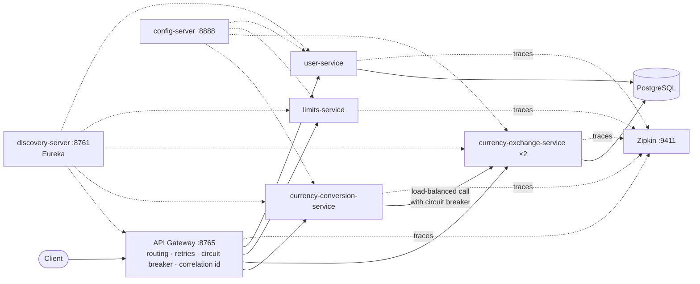

# Spring Microservices Platform

[](https://github.com/Adit12T/spring-microservices-platform/actions/workflows/ci.yml)
[](https://github.com/Adit12T/spring-microservices-platform/actions/workflows/codeql.yml)

A complete microservices system on **Java 21, Spring Boot 3.5 and Spring Cloud 2025.0**: an API gateway,
service discovery, central configuration, four business services, PostgreSQL with Flyway migrations,
circuit breakers, load balancing and distributed tracing. The whole platform starts with one command.

It brings together six small services I wrote in 2018 while learning Spring Cloud (currency exchange,
currency conversion, limits, a Eureka naming server, a config server and a RESTful users service) and
rebuilds them on the current stack, replacing the parts that have since been retired (Zuul, Ribbon,
Hystrix, Spring Cloud Sleuth).

## Architecture



| Module | What it does | Notable features |
|---|---|---|
| `api-gateway` | Single public entry point | Spring Cloud Gateway (WebFlux), `lb://` routing, retry on GET, Resilience4j circuit breaker with a `503` problem-detail fallback and `Retry-After`, `X-Correlation-Id` on every request, exchange rates exposed read-only |
| `discovery-server` | Service registry | Eureka; services find each other by name |
| `config-server` | Central configuration | Serves per-service, per-profile config (`dev`, `prod`) from the repository |
| `currency-exchange-service` | Exchange rates | JPA on PostgreSQL, Flyway migrations, database constraints, ISO-4217 validation, optimistic locking, runs as 2 instances |
| `currency-conversion-service` | Converts amounts | Calls the exchange service through the load balancer with a circuit breaker and 2 s time limit; `BigDecimal` money with banker's rounding |
| `limits-service` | Business limits | Values from the config server, refreshed at runtime with `POST /actuator/refresh` |
| `user-service` | Users and posts | HATEOAS links, validation with field-level errors, Flyway on PostgreSQL |

Every service exports traces to Zipkin and metrics at `/actuator/prometheus`.

## Run it

Needs Docker.

```bash
docker compose up --build
```

Then, through the gateway:

```bash
curl "localhost:8765/api/v1/conversions?from=USD&to=INR&amount=10"
curl  localhost:8765/api/v1/exchange-rates
curl  localhost:8765/api/v1/limits
curl  localhost:8765/api/v1/users/1
```

Run the first command a few times: `rateServedBy` alternates between the two exchange-service
instances. Stop them with `docker compose stop currency-exchange-service` and conversions return a
clean `503` with `Retry-After` instead of hanging.

- Eureka dashboard: http://localhost:8761
- Zipkin traces: http://localhost:9411

## API (through the gateway)

| Method | Path | Service |
|---|---|---|
| `GET` | `/api/v1/conversions?from=USD&to=INR&amount=10` | conversion |
| `GET` | `/api/v1/exchange-rates` and `/api/v1/exchange-rates/{from}/{to}` | exchange |
| `GET` | `/api/v1/limits` | limits |
| `GET`, `POST` | `/api/v1/users`, `/api/v1/users/{id}`, `/api/v1/users/{id}/posts` | users |
| `DELETE` | `/api/v1/users/{id}` | users |

## Tests

```bash
mvn verify
```

No Docker needed: the database services run their Flyway migrations on an in-memory database in
PostgreSQL mode. Tests cover routing and fallbacks in the gateway, profile-specific config, money
rounding and error mapping in conversions, rate validation and updates, HATEOAS links, and limits.

## Limitations

- No authentication at the gateway yet; it is designed as an internal-network demo. The natural next
  step is an OAuth2 resource server at the gateway.
- Sample exchange rates are seeded data, not live market rates.
- Docker Compose runs everything on one machine; it is not a production deployment.

## License

Copyright © 2026 Aditya Tripathi. All rights reserved. The code is published for viewing only; see
[LICENSE](LICENSE). Security reports: see [SECURITY.md](SECURITY.md).
